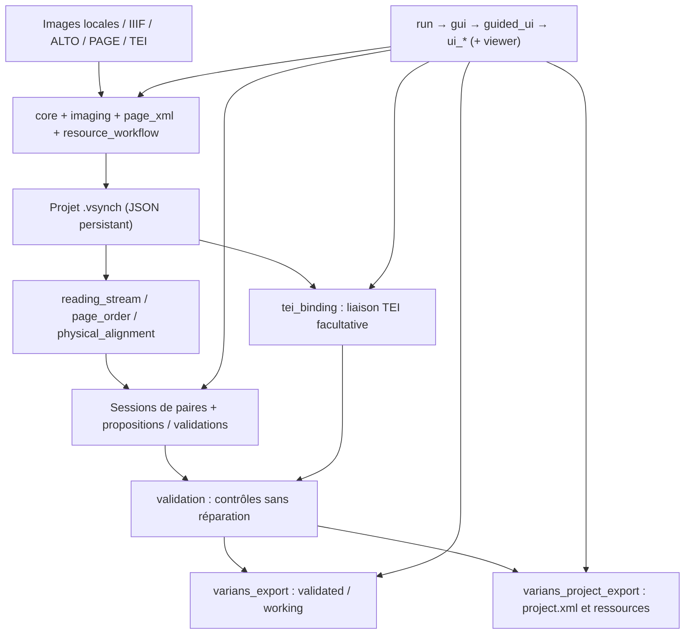

# Architecture et flux de données

## Mission et frontières

Varians-Synchro est un **compagnon de préparation documentaire** pour Varians, éditeur TEI. Il inventorie images et transcriptions de témoins, prépare des correspondances **entre lignes physiques** ALTO/PAGE, peut rattacher un texte TEI réel, puis exporte des structures exploitables par Varians. Il ne crée **pas** un apparat critique, ne remplace pas une décision philologique et ne modifie pas les fichiers sources ALTO/PAGE/TEI.

L'UI est en PySide6 et orchestre des fonctions Python largement utilisables sans GUI. Le projet `.vsynch` est la source de vérité locale ; les documents externes y sont référencés avec leurs métadonnées et parfois un instantané de segmentation, mais leurs originaux restent indépendants.

## Vue en couches

Ce schéma décrit des **responsabilités**, pas la succession de chaque appel ; les exports réalisent eux-mêmes leurs pré-vérifications. `varians_export` n'exige pas qu'une TEI existe ; `varians_project_export` impose une TEI unique pour le témoin pivot.

## Parcours métier canonique

1. Créer le `.vsynch` (`core.new_project`), créer les témoins (`create_witness`), décider du pivot (`resource_workflow.set_project_pivot`). Pivot éditorial **≠** orientation de toute paire physique.
2. Ajouter sources images locales ou Manifest IIIF (`core.add_image_source`, `imaging.parse_manifest`, `imaging.create_pages`). L'import IIIF ne signifie pas que tous les Canvas sont retenus pour l'édition.
3. Importer les XML de segmentation par détection du document (`core.inspect_line_source` → ALTO ou `page_xml.inspect_page_xml`). Les objets de ligne stockent texte HTR, géométrie et ordre.
4. Associer **explicitement** les pages documentaires à leurs fichiers XML (`imaging.bind_line_source`, prévisualisation `bulk_binding`). Une ligne d'un ALTO non associé à une page n'est pas admissible pour l'appariement.
5. Construire le flux de lecture (`reading_stream.reading_stream`) en tenant compte de l'ordre fixé des pages, régions et lignes, et des exclusions de périmètre.
6. Créer des sessions de paires (`physical_alignment.create_pair_session`), calculer des propositions (`automatic`, `textual_progress`, `interpolation`, `residual_alignment`) ; enregistrer les décisions dans `pair_sessions[].links[]`.
7. Si une TEI existe, importer et résoudre les `<lb edRef="#SIGLE"/>` avec `tei_binding`. La liaison à la segmentation est un acte **séparé**, prévisualisé puis confirmé ; les ambiguïtés ne sont pas résolues par devinette.
8. Auditer (`validation.audit_project`) ; exporter soit `validated`/`working` par témoin (`varians_export`), soit un projet Varians initial (`varians_project_export`). Recontrôler les résultats dans l'application Varians visée.

## Architecture d'exécution

`run.py` détecte un noyau Spyder et lance un processus Qt séparé via `spyder_launch`, sinon il appelle `gui.main()`. `gui.main` configure la langue depuis `QSettings('Varians','Varians-Synchro')`, crée une `QApplication` puis construit la fenêtre via `guided_ui.make_guided_window()`, qui rend la classe `GuidedWindow` de `ui_main_window.py`. Les parcours CLI (`audit_vsynch.py`, `recette_v085.py`, `exporter_json_varians.py`) n'importent pas Qt pour exécuter leur travail principal.

## Règles de flux

- Imports et prévisualisations : ne pas publier de mutation avant vérification ; sur annulation, préserver projet ouvert + chemin + modifications en mémoire.
- Recalcul : ne pas détruire les ancres manuelles ou validées, ni les groupes absents.
- Sérialisation : le `.vsynch` garde l'historique des décisions et est sauvegardé atomiquement ; l'export est **un résultat dérivé**, jamais la source de vérité.
- Les données éditoriales et les identifiants ne passent **jamais** dans les catalogues i18n.
